<p align="center">
  
</p>

<h1 align="center">Wesco Tank</h1>

<p align="center">
  <b>Fuel tracking and fleet CRM: a mobile app for drivers and an admin portal for dispatchers.</b>
</p>

<p align="center">
  
  
  
  
  
  
</p>

> 🔒 **This is a showcase repository.** It contains the description and screenshots only. The source code is private.
> All screenshots use synthetic demo data.

<p align="center">
  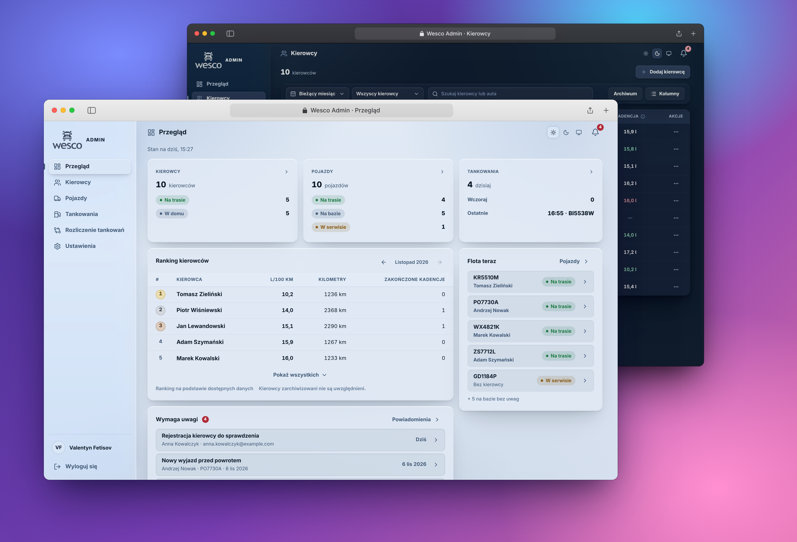
</p>

## What is Wesco Tank?

Wesco Tank replaces spreadsheets and chat messages with a single system for fuel and fleet operations. It has two parts:

- **Driver app.** A mobile-first PWA. A driver logs a fueling in under a minute and sees personal statistics and consumption.
- **Admin portal.** A working environment for fleet managers: drivers, vehicles, fueling records, anomaly alerts, reports and access control. It has grown into a complete CRM for a vehicle fleet.

Data is entered once. Consumption, mileage, trips, rankings, alerts and reports are calculated automatically.

---

## Driver app

<p align="center">
  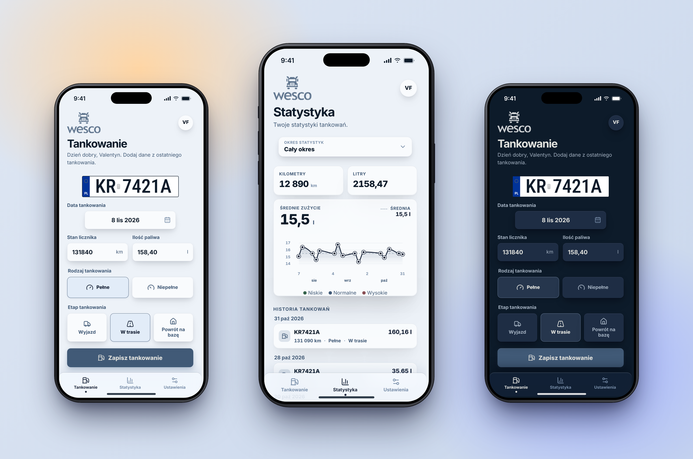
</p>

Three tabs: **Tankowanie** (fueling), **Statystyki** (statistics) and **Ustawienia** (settings).

| | |
|---|---|
| ⛽ **Fast fueling entry** | Date, odometer, liters, full or partial tank, and trip stage: departure, en route, return to base. The vehicle is filled in automatically. |
| 📊 **Personal statistics** | Kilometers, liters, average consumption against the vehicle norm, a trend chart and fueling history. |
| 🗓️ **Flexible periods** | Current, previous or custom date range. |
| 📍 **Optional location** | The fueling place can be saved when the driver opts in. |
| 💳 **Fuel cards** | The driver sees the DKV and Tankpool cards assigned to their vehicle. A card PIN is revealed only on press and hold. |
| 🔐 **Simple sign-in** | Registration and sign-in with a 6-digit PIN. The session persists between launches. |
| 🌍 **Three languages** | Polish, Ukrainian and Russian. The language is detected on first launch and can be changed manually. |
| 🌗 **Themes** | System, Light and Dark. |
| 📲 **Installable PWA** | Add it to the home screen. Designed for one-handed use. |

<p align="center">
  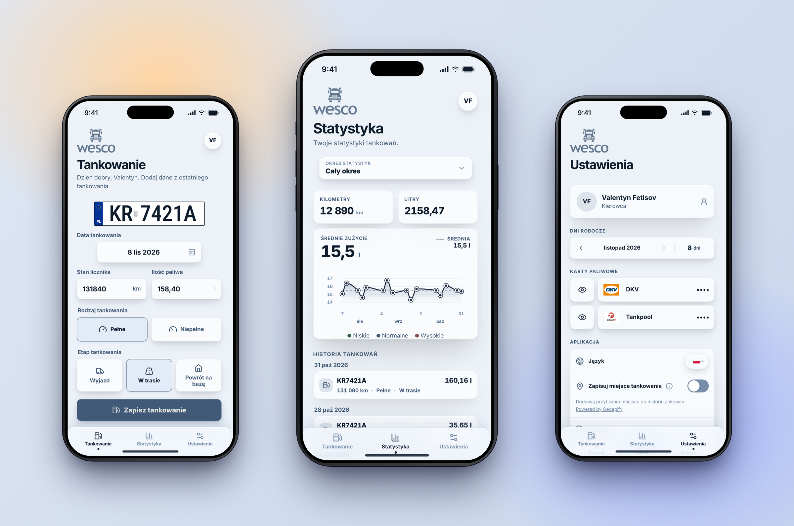
  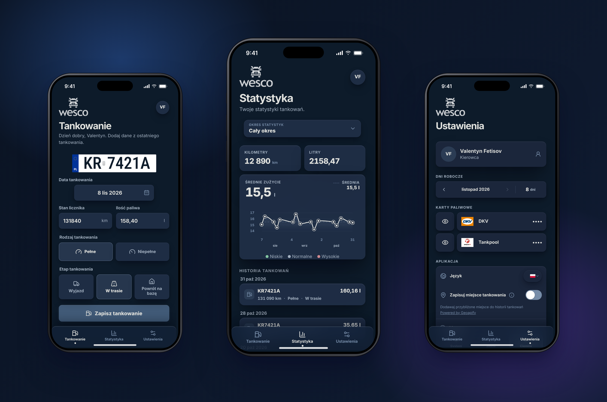
</p>

---

## Admin portal

The admin portal runs in the browser and adapts to smaller screens. It offers three languages and light and dark themes.

### 📈 Overview
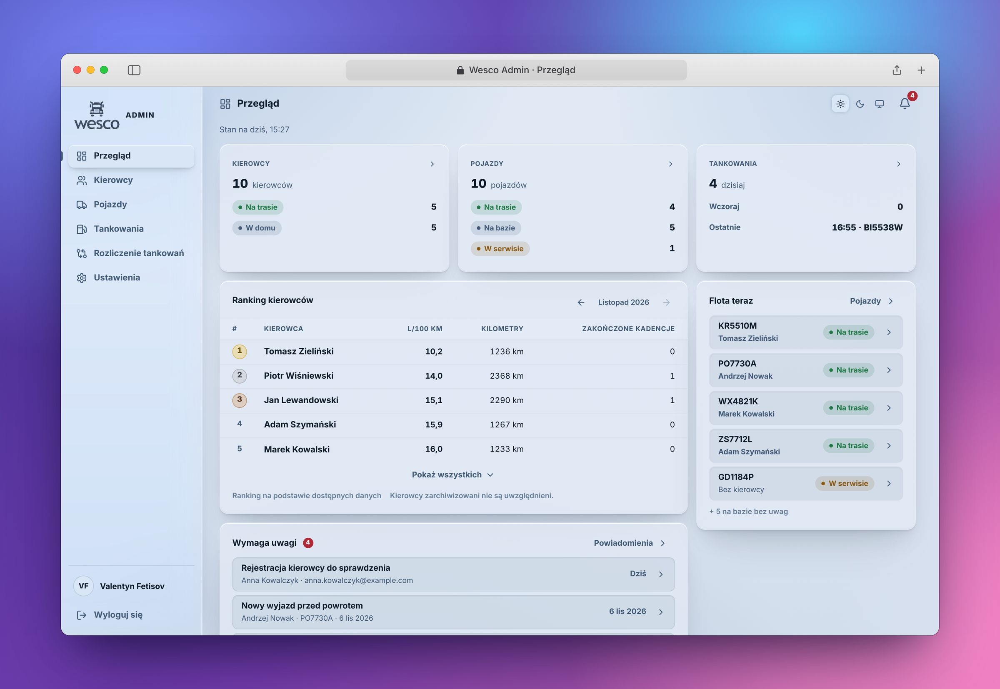

An operational summary for today:
- an **Attention** block with fresh alerts;
- the **latest fuelings**;
- **fleet now**: which vehicles are on a trip, at base or in service;
- a **monthly driver ranking** (TOP 3 / TOP 5) by consumption, mileage and completed trips, with month switching.

### 👥 Drivers
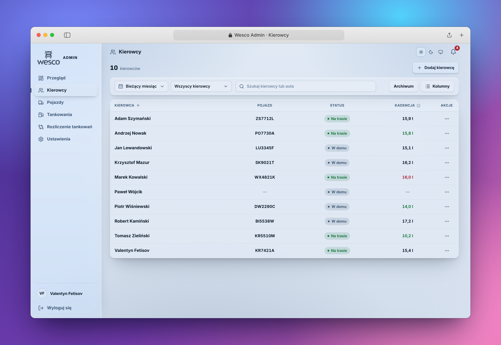

- A searchable, sortable list with configurable and reorderable columns and a one-click "clear filters".
- Operational status (on a trip or at home), app registration state and active or inactive state.
- **Period analytics**: liters, kilometers and average consumption for any period. Consumption is colored relative to the vehicle norm.
- **Sign-up approval**: an administrator links a new account to the correct driver record.
- Create, activate, deactivate, archive and restore drivers. History is always preserved.

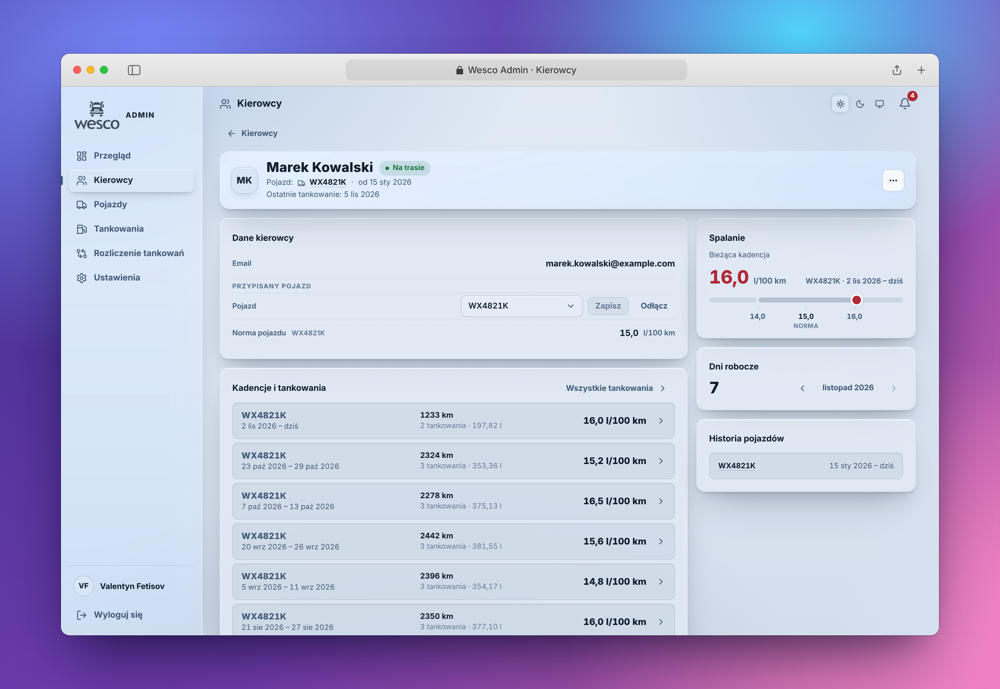

A driver page shows the assigned vehicle and its norm, current consumption on a norm scale, every trip with distance, fuel and consumption, working days, and the vehicle history.

### 🚚 Vehicles
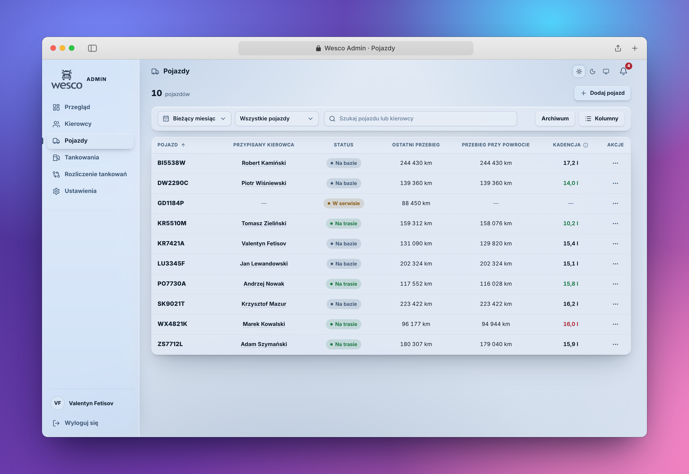

- The fleet with statuses **at base / on a trip / in service**.
- Consumption norm, current odometer, odometer at last return, last fueling, assigned driver and period analytics.
- Add, archive and restore vehicles. A new vehicle can be assigned to a free driver right away.
- **Service and repair**: start and finish with a reason (breakdown, planned service, other).

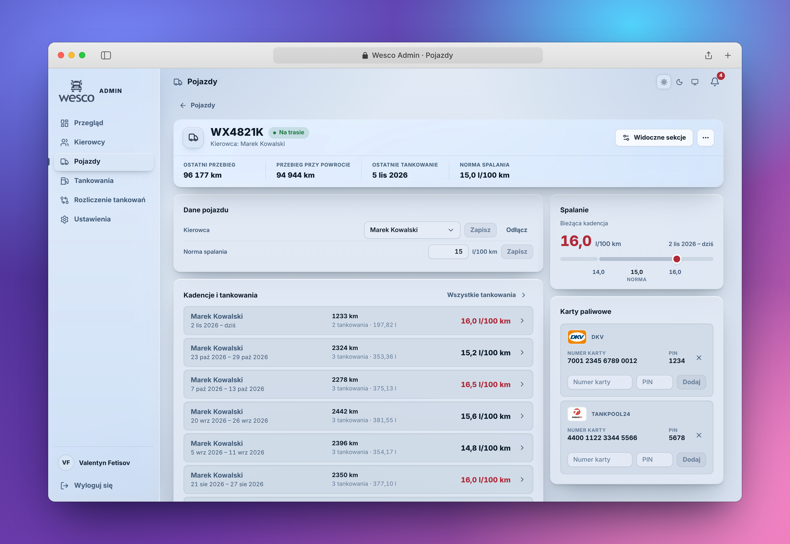

A vehicle page shows the driver, the norm, trips by every driver who used the vehicle, and **fuel cards** (DKV, Tankpool) that are shown to the assigned driver in the app.

### ⛽ Fuelings
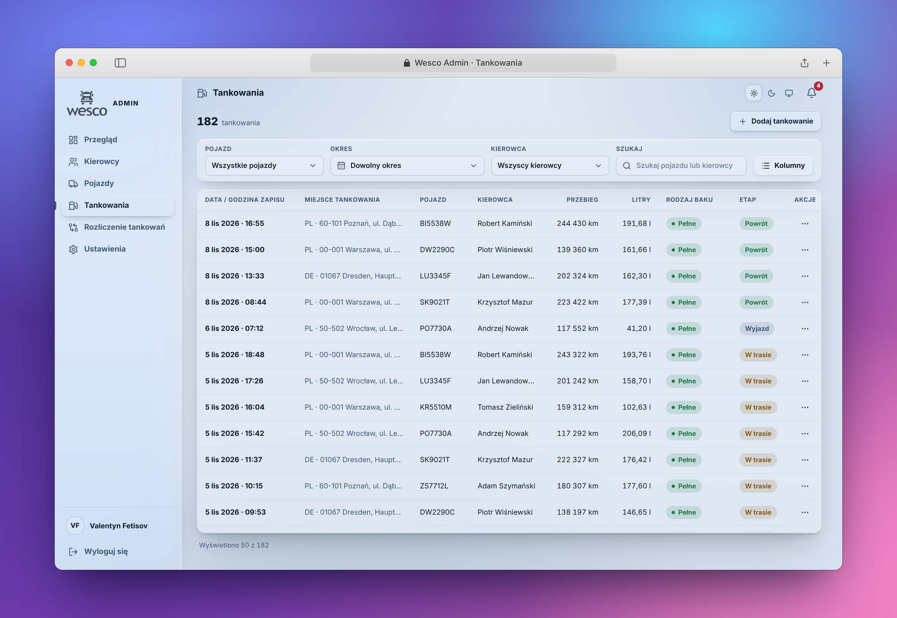

- One registry for all fuelings with filters by vehicle, driver, period and trip, plus search.
- Fueling details: address, GPS coordinates, entry time, and who created or changed the record.
- **Manual add, edit and delete** by an administrator. Every change is written to an audit trail.
- Protection against duplicates and inconsistent odometer readings.

### 🔔 Notifications
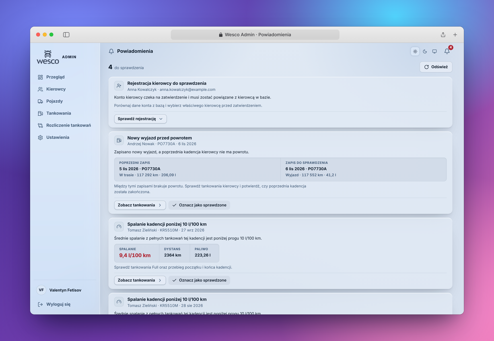

The system finds suspicious situations on its own and explains them with a hint on what to check:
- a new departure while the previous trip is still open;
- an "en route" fueling without a departure;
- a return without an open trip;
- suspiciously low consumption (below 10 l/100 km);
- new sign-ups that could not be linked to any driver.

Each alert has **"View fuelings"**, which opens the relevant records for the right period.

### 🧾 Fuel reconciliation *(in progress)*
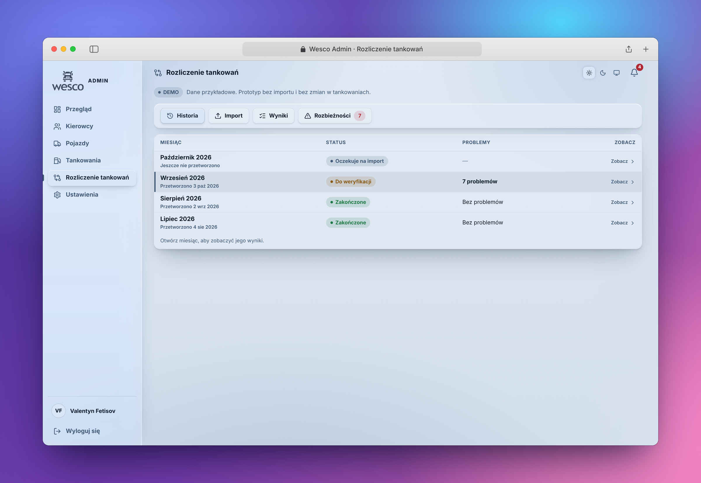

A section for comparing Wesco fueling records against supplier settlements (DKV, Tankpool). It is under active development. The planned flow: upload supplier files for a month, match transactions automatically, compare liters, dates and odometer values, and work through a queue of discrepancies. Fueling records are never changed automatically.

### ⚙️ Settings
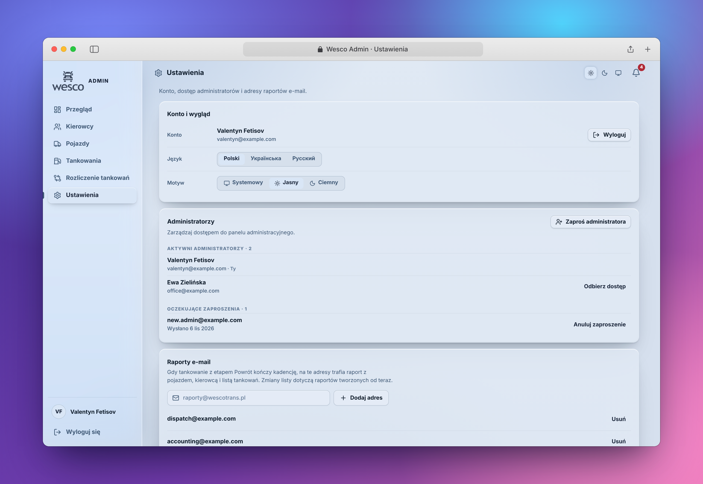

- Language and theme.
- **Administrators**: invite by email with a secure one-time link, cancel invitations, revoke access.
- **Email reports**: the list of recipients for trip reports.

### 🌗 Dark theme
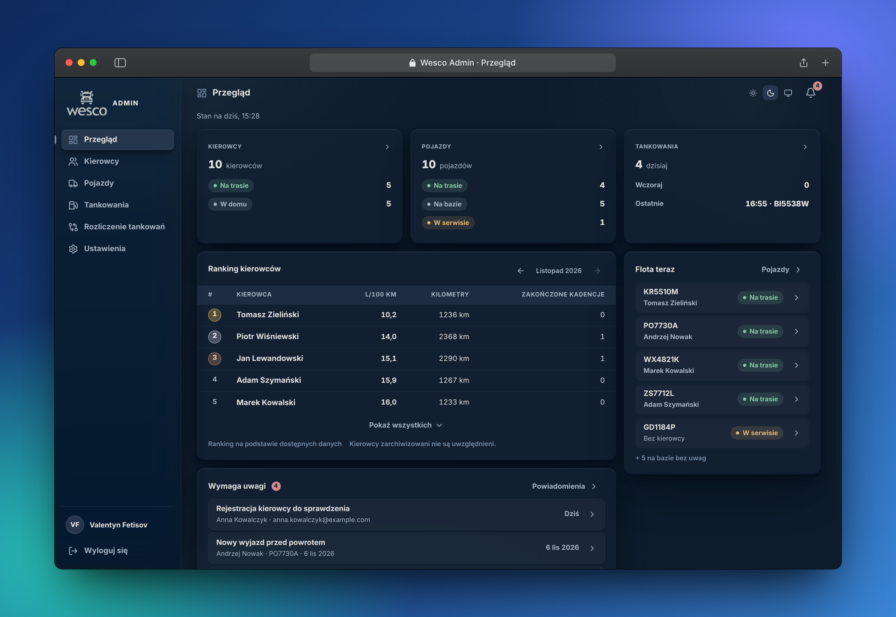

---

## Automation

### 📧 Trip reports by email
When a fueling with the stage "return to base" closes a trip, a report goes out to the configured recipients automatically. It contains the vehicle, the driver, distance, consumption compared with the norm and the list of fuelings. Delivery is tracked, with retries, uncertain-state handling and duplicate protection.

### 🤖 Telegram admin bot
A private bot for the owner:
- a quick summary card of drivers;
- business notifications: new sign-ups, trip reports, anomalies;
- a navigation menu with a direct link to the admin portal;
- hand-over of bot administration to another account with a one-time code.

---

## How consumption is calculated

The same rules apply in the driver app, the admin portal, email reports and Telegram:

- A **trip** (cadence) covers fuelings from departure to return, inclusive.
- Consumption is calculated only over completed **full tank → full tank** intervals of a single vehicle.
- A trip's mileage is measured from the previous full return fueling of the same vehicle. A vehicle handed over between drivers still gives a correct result.
- Consumption is classified against the **norm of the specific vehicle**: more than 1 l/100 km below the norm, within ±1 l/100 km (neutral), or more than 1 l/100 km above it.

---

## Architecture

```text
   Driver app (PWA)           Admin portal
          │                         │
          └───────────┬─────────────┘
                      ▼
        Supabase (Postgres · Auth · Row Level Security · RPC)
                      │
          ┌───────────┴───────────┐
          ▼                       ▼
    Email reports           Telegram bot
    (Cloudflare Workers, scheduled jobs)
```

## Tech stack

**React · TypeScript · Vite · PWA** on the client. **Supabase** (Postgres, Auth, Row Level Security, RPC functions) on the backend. **Cloudflare Workers** for hosting and background jobs. Automated tests cover the calculation logic and the database contracts.

## Status

Under active development and used day to day as an internal fleet system.

---

<sub>© Wesco Tank. All rights reserved. Source code is private.</sub>
